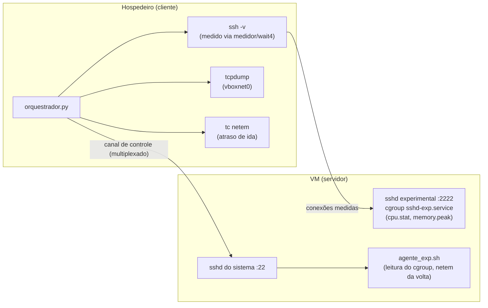

# Metodologia experimental

Este documento descreve como o orquestrador mede cada conexão e quais
decisões de instrumentação sustentam os resultados do TCC.

## Arquitetura

- **Conexões medidas** vão para um sshd experimental na porta 2222, isolado em
  um cgroup próprio. Ele herda a configuração efetiva do sshd original
  (`sshd -T`) e, portanto, anuncia a mesma lista de KEX, cifras e chaves de
  host. A CPU e a memória do servidor contam apenas os processos dessa conexão
  (`sshd-session`, `sshd-auth` e o listener).
- **Canal de controle**: o sshd do sistema (porta 22), com uma conexão
  multiplexada persistente, lê o cgroup antes e depois de cada conexão e
  aplica o netem do lado do servidor — sempre fora da janela medida.
- **Emulação de rede**: o RTT configurado é dividido em duas metades — o atraso
  de ida é aplicado na `vboxnet0` do hospedeiro e o de volta na interface da VM.
  O limite de banda vale para os dois sentidos.

## Desenho experimental

- 3 cenários × 4 condições de rede × 30 rodadas (blocos pareados).
- Em cada rodada, os três cenários são executados em ordem alternada, para
  evitar efeitos sistemáticos de posição.
- Conexões de aquecimento (3 por cenário e condição) são descartadas.
- Cada conexão executa o comando `echo ok` e verifica a resposta.

## Métricas de tempo

Todas as medidas de tempo do handshake vêm da captura no cliente.

| Coluna | Início | Fim |
|---|---|---|
| `T_kex_ms` (principal) | 1ª mensagem específica de KEX do cliente (30) | NEWKEYS do cliente (21) |
| `T_kex_completo_ms` | KEXINIT do cliente (20) | NEWKEYS do cliente |
| `T_kex_especifico_ms` | mensagem 30 do cliente | resposta 31 do servidor |
| `T_transporte_ms` | SYN do cliente | NEWKEYS do cliente |
| `T_autenticado_proc_ms` | início do processo `ssh` | linha `Authenticated to` no log do cliente |
| `T_canal_proc_ms` | início do processo `ssh` | linha `Sending command:` (canal aberto) |
| `T_processo_ms` | início do processo `ssh` | término do processo |
| `T_autenticado_ms`, `T_canal_ms` | SYN capturado | as mesmas linhas do log |
| `rtt_tcp_ms` | SYN | SYN/ACK no ponto de captura |

**Ponto de captura e netem.** O `tcpdump` na `vboxnet0` registra os pacotes
que saem do cliente depois do atraso do netem. Consequências:

- `rtt_tcp_ms` mostra só a metade do RTT aplicada na VM; o RTT completo está
  no ping registrado no manifesto;
- intervalos entre dois pacotes enviados pelo cliente (`T_kex_ms`,
  `T_kex_completo_ms`, `T_transporte_ms`) não são afetados;
- `T_autenticado_ms` e `T_canal_ms` ficam subestimados em RTT/2 nas condições
  com atraso — por isso o TCC usa as versões `*_proc_ms`.

## CPU, memória e rede

- **CPU e memória do cliente**: o `medidor` cria o `ssh` com `fork()` e lê o
  `ru_maxrss` e o tempo de CPU via `wait4`. Medindo direto do Python, o valor
  herdaria o pico de memória do próprio interpretador.
- **CPU e memória do servidor**: lidas do cgroup do sshd experimental
  (`cpu.stat`, `memory.peak`). A memória do cgroup inclui o cache de páginas
  atribuído aos processos; com um único conjunto de processos por vez, o pico
  é um pico simultâneo verdadeiro. O pico é reiniciado a cada conexão; como no
  kernel ≥ 6.12 esse reinício vale só para o descritor que o fez, o agente
  mantém um processo auxiliar com o descritor aberto durante a conexão (fora
  do cgroup medido).
- CPU e memória cobrem a conexão inteira: estabelecimento, autenticação,
  comando e encerramento.
- **Rede**: bytes de carga útil TCP do SYN até o NEWKEYS do cliente,
  deduplicados por número de sequência; também são registrados pacotes,
  retransmissões e os totais da conexão inteira.
- **Bytes de KEX** (`kex_bytes_*`): soma apenas dos pacotes SSH 30 e 31
  (`packet_length` + 4). Uma versão anterior da coleta contava o segmento TCP
  inteiro da resposta do servidor, que também carrega o NEWKEYS e a primeira
  mensagem cifrada; por isso o valor do servidor aqui é 364 bytes menor (por
  exemplo, 192 em vez de 556 no clássico). Os volumes totais não mudam.
- **Autenticação e canal**: o tráfego após o NEWKEYS é cifrado, então esses
  instantes vêm do log `-v` do cliente, com o relógio do mesmo hospedeiro que
  faz a captura. O nível de log é o mesmo nos três cenários.

## Testes de estabilidade

Executados em cada condição de rede, com 10 repetições:

| Teste | O que faz | Resultado esperado |
|---|---|---|
| `rekey` | Transfere 8 MiB com `RekeyLimit=1M` | sucesso, com 2 ou mais NEWKEYS |
| `fallback` | Cliente prefere um método que o servidor não anuncia | negocia o método do cenário |
| `kex_nao_suportado` | Cliente oferece só um método não anunciado | `rejeicao_controlada` |
| `banner_invalido` | Envia um banner que não é SSH | `encerramento_controlado` |
| `pacote_invalido` | Banner válido seguido de pacote com comprimento inválido | `encerramento_controlado` |

O método "não anunciado" é escolhido automaticamente comparando `ssh -Q kex`
do cliente com o `sshd -T` do servidor (na campanha oficial,
`diffie-hellman-group1-sha1`). Após cada teste, verifica-se que o sshd
experimental continua ativo.

## Análise estatística

Implementada em `analisar.py`:

- descritivas por condição, métrica e cenário: n, média, mediana, DP, Q1, Q3,
  IQR, mínimo, máximo, P95, CV e IC 95%;
- diferenças absolutas e relativas (média e mediana) entre pares de cenários;
- teste de Friedman com W de Kendall sobre os blocos pareados e, em seguida,
  Wilcoxon pareado com correção de Holm.

## Rastreabilidade e segurança

- Cada campanha grava um `manifesto.json` com versões e *commits* do OpenSSH e
  da liboqs, compilador e flags, hardware, SO, *offloads* da interface,
  configuração efetiva do sshd, qdisc aplicada, RTT do ping e hashes SHA-256
  dos scripts usados.
- Nenhum arquivo registra chaves privadas, segredos compartilhados ou chaves
  de sessão; o tráfego SSH nas capturas é cifrado.
- O orquestrador remove o netem do cliente e do servidor ao terminar, inclusive
  se interrompido com Ctrl+C.
